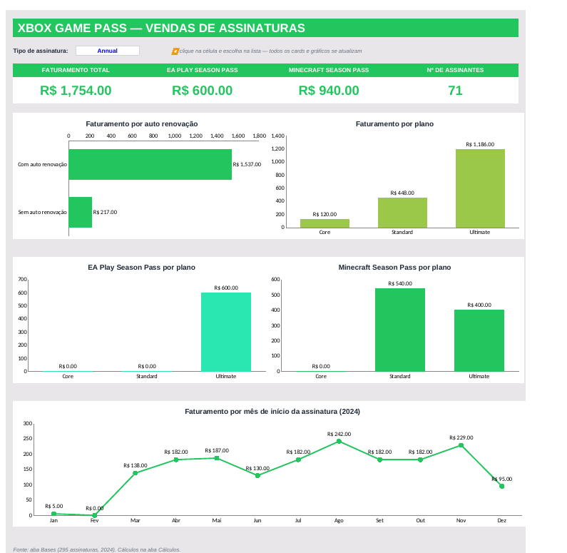

# 🎮 Dashboard de Vendas — Xbox Game Pass (Excel)

Dashboard em Excel que transforma uma base bruta de assinaturas do Xbox Game Pass em indicadores e gráficos claros, para apoiar a análise de desempenho de vendas e a tomada de decisão.

> Projeto do desafio da DIO: *Criando um Dashboard de Vendas do Xbox com Excel*.



## 🎯 Perguntas de negócio respondidas

| # | Pergunta | Onde está |
|---|---|---|
| 1 | Qual o faturamento total de vendas dos planos (assinaturas agregadas)? | Card **Faturamento Total** |
| 2 | Qual o faturamento total separado por **com** e **sem** auto renovação? | Gráfico *Faturamento por auto renovação* |
| 3 | Qual o total de vendas das assinaturas do **EA Play**? | Card + gráfico *EA Play Season Pass por plano* |
| 4 | Qual o total de vendas do **Minecraft Season Pass**? | Card + gráfico *Minecraft Season Pass por plano* |

Extras: faturamento por plano, número de assinantes e faturamento por mês de início da assinatura.

## 🔎 Filtro interativo

Na aba **Dashboard**, a célula **Tipo de assinatura** tem uma lista suspensa (`Todos`, `Annual`, `Quarterly`, `Monthly`). Ao trocar a opção, todos os cards e gráficos se atualizam.
O filtro vem em **Annual**, pois a pergunta 1 fala de planos anuais. Escolha **Todos** para ver o total geral.

Resultados com o filtro em **Annual**: faturamento R$ 1.754 (R$ 1.537 com auto renovação e R$ 217 sem), EA Play R$ 600 e Minecraft Season Pass R$ 940, em 71 assinaturas.

## 📊 Os dados

Aba **Bases**: 295 assinaturas iniciadas em 2024.

| Coluna | Descrição |
|---|---|
| Subscriber ID, Name | Identificação do assinante |
| Plan | Core, Standard ou Ultimate |
| Start Date | Data de início |
| Auto Renewal | Yes / No |
| Subscription Price / Type | Preço e tipo (Monthly, Quarterly, Annual) |
| EA Play Season Pass (+ Price) | Se contratou o EA Play e o valor |
| Minecraft Season Pass (+ Price) | Se contratou o Minecraft Season Pass e o valor |
| Coupon Value | Desconto aplicado |
| Total Value | Valor total da venda |

## 🗂️ Estrutura do arquivo

- **Dashboard**: cards de indicadores, filtro e 5 gráficos
- **Cálculos**: uma seção por pergunta de negócio, com fórmulas `SOMASES` (SUMIFS), `CONT.SES` (COUNTIFS) e `SE`, e conferências de que os totais fecham
- **Bases**: dados brutos

## ▶️ Como reproduzir

1. Baixe `Dashboard_Xbox.xlsx` e abra no Excel.
2. Na aba **Dashboard**, escolha o tipo de assinatura na lista suspensa.
3. Para ver como cada número é calculado, abra a aba **Cálculos**.
4. Para usar outros dados, substitua o conteúdo da aba **Bases** mantendo as colunas. Se a base ficar maior que 295 linhas, ajuste os intervalos das fórmulas (`Bases!$A$2:$M$296`).

## 🧠 Aprendizados

- Separar dados, cálculos e visualização em abas diferentes
- Responder perguntas de negócio com `SOMASES` e filtros dinâmicos
- Montar gráficos que contam uma história e seguem uma paleta de cores coerente
- Documentar o projeto no GitHub

## 📁 Arquivos

```
├── README.md
├── Dashboard_Xbox.xlsx
└── dashboard.png
```
